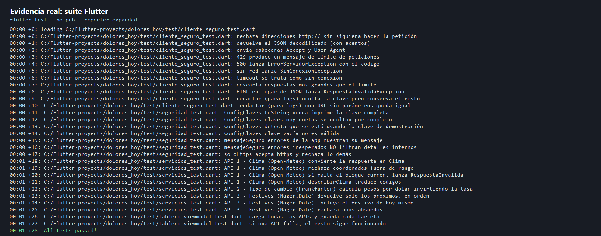
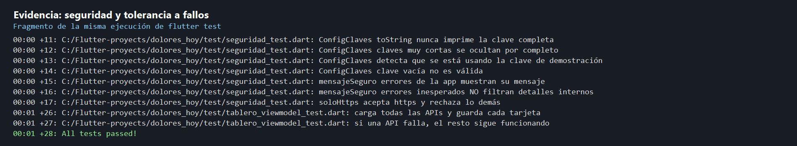

# Dolores Hoy

Aplicación Flutter que consume 5 APIs gratuitas con buenas prácticas de seguridad: clima, tipo de cambio, festivos, Wikipedia y NASA.

## Objetivo

Construir un tablero de información de Dolores Hidalgo con:
- clima actual
- tipo de cambio
- próximos festivos
- resumen de Wikipedia
- foto astronómica del día de la NASA

Todo esto siguiendo buenas prácticas de seguridad: HTTPS obligatorio, claves fuera del código, validación de entradas y salidas, manejo de errores amigables y recuperación por API.

## Requisitos

- Flutter SDK instalado
- Un dispositivo o emulador disponible
- Una clave de NASA opcional para pruebas reales (se usa `DEMO_KEY` por defecto)

## Ejecución

1. Instala dependencias:
   flutter pub get

2. Ejecuta la app:
   flutter run --dart-define-from-file=secrets.json

3. O bien, si prefieres pasar la clave directamente:
   flutter run --dart-define=NASA_API_KEY=tu_clave_aqui

## Pruebas y validación

Ejecuta la suite completa desde la raíz del proyecto:

```powershell
flutter test --no-pub --reporter expanded
```

Las pruebas usan `MockClient`, así que no necesitan conectarse a las APIs ni consumir la cuota de NASA. En la ejecución registrada pasaron **28 pruebas**.

### Cobertura actual

| Archivo | Qué comprueba |
| --- | --- |
| `test/cliente_seguro_test.dart` | HTTPS obligatorio, cabeceras, errores HTTP, falta de conexión, timeout, límite de tamaño, JSON inválido y ocultamiento de claves en URL. |
| `test/servicios_test.dart` | Conversión y validación para Open-Meteo, Frankfurter y Nager.Date. |
| `test/seguridad_test.dart` | Protección de la clave NASA, mensajes de error seguros y aceptación exclusiva de imágenes HTTPS. |
| `test/tablero_viewmodel_test.dart` | Carga simulada de las cinco APIs y aislamiento cuando falla una de ellas. |

El manual propone probar cada API con respuestas simuladas y centralizar las defensas en `ClienteSeguro`; el proyecto sigue ese enfoque. La cobertura de servicios individual todavía no incluye pruebas dedicadas para Wikipedia y NASA: ambas aparecen en la prueba integrada del tablero.

### Capturas de la actividad

Las capturas muestran la salida real de la suite de pruebas; el registro de texto completo también está guardado en `captures/pruebas_flutter.txt`.





### Verificación de seguridad
- `secrets.json` debe mantenerse fuera del repositorio
- la clave NASA no debe estar escrita en el código fuente
- las llamadas HTTP deben usar siempre HTTPS
- los errores mostrados al usuario deben ser mensajes seguros, sin secretos ni rutas internas

## Archivos clave

- `lib/datos/cliente_seguro.dart` — único punto de salida HTTP
- `lib/datos/servicios.dart` — servicios de cada API
- `lib/datos/config_claves.dart` — manejo de la API key de la NASA
- `lib/presentacion/tablero_viewmodel.dart` — estado y carga paralela de las cinco APIs
- `lib/presentacion/pantalla_tablero.dart` — interfaz del tablero
- `test/cliente_seguro_test.dart` — pruebas del cliente seguro
- `test/servicios_test.dart` — pruebas unitarias de servicios de API
- `test/seguridad_test.dart` — pruebas de seguridad
- `test/tablero_viewmodel_test.dart` — pruebas del tablero
- `secrets.json` — valores locales de la clave (ignorado por Git)
- `secrets.json.example` — plantilla compartible sin secretos reales

## Nota

La clave por defecto es `DEMO_KEY`. Esto permite practicar sin registrar una clave real, pero el proyecto está preparado para usar una clave propia cuando se quiera probar contra la API de la NASA con cuotas reales.
